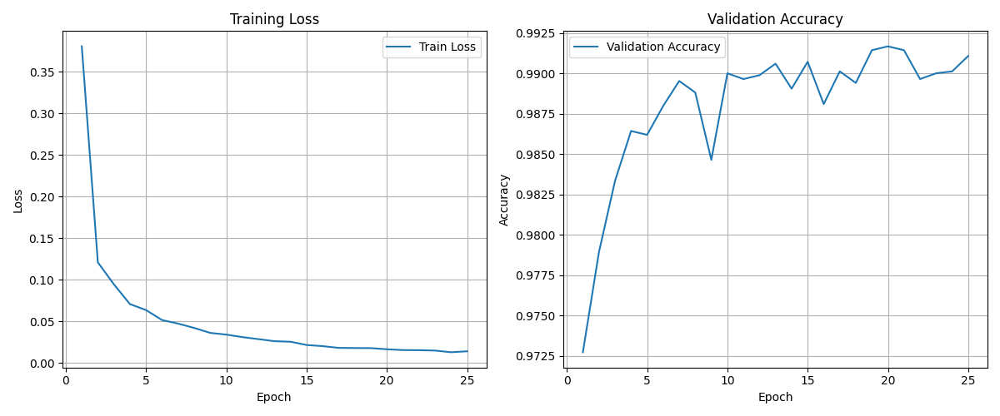
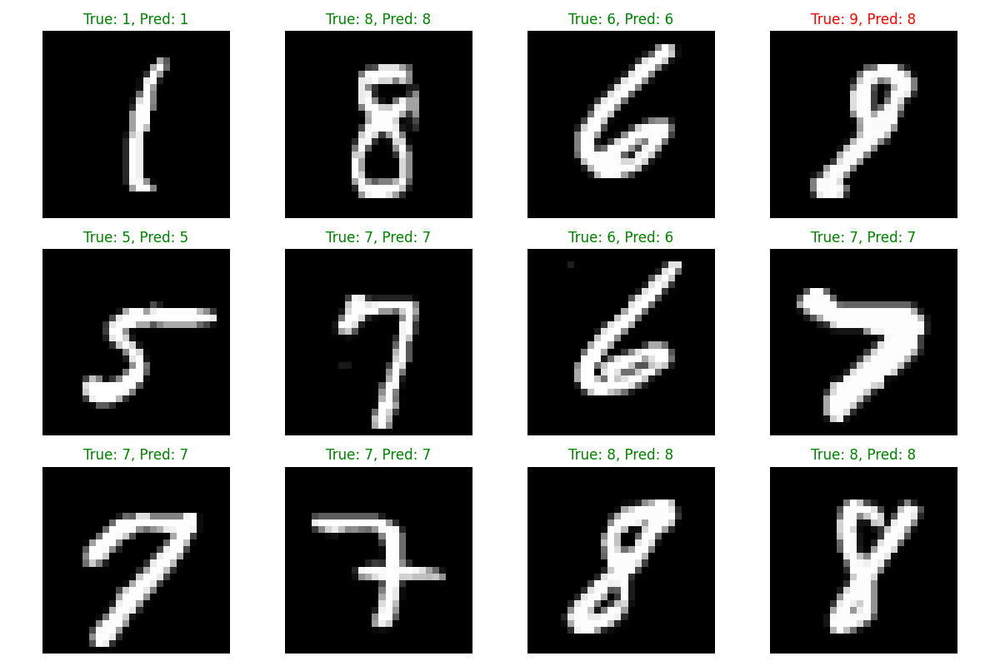

# 基于PyTorch的手写数字识别
## 一、项目简介
本项目基于PyTorch框架，使用卷积神经网络，实现手写数字识别

项目使用MNIST数据集，识别范围为0-9共10个数字类别。通过构建CNN模型，完整实践深度学习图像分类任务的主要流程
## 二、项目内容
1. 数据读取与预处理
2. 自定义DataLoader和Dataset(Mini-Batch)
3. 构建CNN网络
4. 前向传播与反向传播
5. 交叉熵损失函数
6. Adam优化器
7. Dropout 正则化
8. Early Stopping早停机制
9. 模型训练、保存与加载
10. 模型评估与混淆矩阵分析
11. 预测结果可视化
## 三、项目整体流程处理
项目按照深度学习图像分类任务的基本流程进行，从原始数据读取开始，依次完成数据预处理、数据集构建、CNN网络构建、模型训练、参数优化、模型评估、预测结果可视化等步骤。具体流程如下：
### 3.1数据读取与预处理
首先读取Kaggle提供的训练数据集。原始数据以csv文件的形式存储，每一行代表一张手写数字图片。
数据包含两部分信息：
1. 标签(Label):表示图片对应的真实数字，取值范围为0-9共10个数字类别。
2. 像素值(Pixel Value):表示图片中每个像素点的灰度值，取值范围为0-255。每张图片由28*28个像素组成，共784个像素点。

在读取数据后，将图片像素与对应标签进行拆分，为后续的数据预处理和模型训练做准备。
### 3.2数据预处理
原始csv数据不能直接输入CNN，需要先将其转换为适合神经网络处理的张量格式。具体步骤如下：
1. 分离特征与标签，将图片像素值与对应标签进行拆分。
2. 像素值归一化：将像素值从0-255的范围缩放到0-1的范围，以减少模型训练过程中的数值差异。使模型能够更加稳定地进行参数优化
3. 调整图片形状，原始图片以长度为784的一维数组形式存储，需要将其调整为28*28的二维数组，以便后续卷积操作。由于PyTorch的卷积层要求输入数据的形状为(N,C,H,W)，因此需要将数据调整为四维张量。
### 3.3构建数据集与数据加载器
完成数据预处理后，使用PyTorch的Dataset和DataLoader组织数据
首先，通过自定义DigitDataset类继承PyTorch的Dataset类，实现数据集的基本访问功能。该类包含两个主要方法：
1. __len__()：返回数据集的大小，即图片的数量。
2. __getitem__()：根据给定的索引返回对应图片及其标签。

然后，使用PyTorch的DataLoader类构建数据加载器，实现数据集的批量加载、打乱、多线程读取等功能。通过设置batch_size参数，可以控制每个批次加载的图片数量，从而实现Mini-Batch训练。
同时，将原始训练数据划分为训练集和验证集：

·训练集:用于模型学习，通过反向传播更新网络参数。

·验证集:用于评估模型在未参与参数更新的数据上的表现，并辅助选择最佳模型。
### 3.4构建CNN网络
采用两组卷积层与最大池化层提取图像特征再通过全连接层完成数字分类。具体网络结构如下：
1. 卷积层(Convolutional Layer):通过卷积核提取图像中的局部特征，例如边缘、笔画和局部形状等。随着网络层数增加，卷积核逐渐捕捉到更复杂的特征。
2. 激活层(Activation Layer):使用ReLU激活函数，引入非线性变换，使模型能够学习更复杂的特征。
3. 池化层(Pooling Layer):对卷积结果进行下采样，减少特征图的尺寸，减少后续计算，同时保留局部区域中较为显著的特征。
4. Flatten Layer:将二维特征图展平为一维向量，以便输入全连接层。
5. 全连接层(Fully Connected Layer):通过全连接层将提取的特征映射到10个分类结果，分别对应0-9。
6. Dropout Layer:在全连接层中加入dropout，以一定概率屏蔽部分神经元，降低网络对特定神经元的过度依赖，缓解过拟合问题。
### 3.5模型训练与参数优化
模型结构定义完成后，开始进行训练。训练的核心是通过前向传播计算预测结果，利用损失函数衡量预测误差，再通过反向传播计算梯度，并使用优化器更新网络参数，使模型逐步学习输入图片与数字类别之间的关系。

整个训练过程主要包括以下四个步骤
1. **前向传播**（Forward Propagation）
每次训练从DataLoader中读取一个Mini-batch，将图片输入CNN，依次经过卷积层、ReLU激活函数、最大池化层和全连接层，最终得到模型的预测结果。
对于每张图片，模型输出10个类别分数，分别对应数字0～9。通过前向传播，模型将输入图片转换为分类结果，为后续的损失计算提供依据。
2. **损失计算**（Loss Calculation）
本项目采用交叉熵损失函数(Cross Entropy Loss)衡量模型预测结果与真实标签之间的差异。
损失值反映了模型当前的预测误差。训练的目标是通过不断调整网络参数，使损失逐渐降低，从而提高模型的分类能力。
3. **反向传播**（Backward Propagation）
完成损失计算后，使用 PyTorch 的自动求导机制执行反向传播：
```python
loss.backward()
```
4. **优化器更新参数**（Parameter Update）
本项目使用Adam优化器更新模型参数：
```python
optimizer.step()
```
Adam根据当前梯度及其历史统计信息，自适应地调整不同参数的更新步长，从而优化网络参数。
在每个Mini-batch开始训练前，需要调用：
```python
optimizer.zero_grad()
```
清空上一轮累积的梯度，避免梯度错误累加。

上述四个步骤不断重复，构成神经网络的核心训练循环：
**前向传播 → 计算损失 → 反向传播 → 更新参数。**
随着训练不断进行，模型逐渐学习到手写数字的特征，并提高分类准确率。
## 四、项目目录结构与核心代码说明
### 4.1 项目目录结构
本项目采用模块化的代码组织方式，将数据处理、模型构建、训练和预测等核心功能分别放在不同的 Python 文件中，便于代码管理和后续维护。

项目目录结构如下：
```text
digit-recognizer/
│
├── data/                           # 数据集目录
│   ├── train.csv                   # 训练数据集
│   ├── test.csv                    # 官方测试数据集
│   └── sample_submission.csv       # 预测结果文件
│
├── src/                            # 项目核心代码
│   ├── dataset.py                  # 自定义数据集
│   ├── data_loader.py              # 数据读取与预处理
│   ├── model.py                    # CNN 模型定义
│   ├── train.py                    # 模型训练与验证
│   ├── test.py                     # 验证集准确率评估
│   └── predict.py                  # 官方测试集预测
│
├── training_curves.png             # 训练曲线
├── prediction_results.png          # 预测结果可视化
├── .gitignore                      # Git 忽略文件配置
├── requirements.txt                # 项目依赖库
└── README.md                       # 项目说明文档
```
其中，`data/` 目录保存项目所需的完整数据文件，`src/` 目录存放模型训练和预测的核心代码。训练曲线和预测结果图片用于展示模型的实验效果。
### 4.2 核心代码文件说明
**1. `dataset.py` —— 自定义数据集**
定义PyTorch Dataset类，通过`__len__()`和`__getitem__()`实现数据集的长度获取和样本读取，将数据转换为模型可以使用的Tensor。

**2. `data_loader.py` —— 数据读取与预处理**
负责读取CSV数据，分离图像和标签，对像素值进行归一化，将一维像素数据转换为CNN所需的图像张量，并划分训练集和验证集，创建DataLoader。

**3. `model.py` —— CNN 模型定义**

定义卷积神经网络结构，主要包括卷积层、ReLU激活函数、最大池化层、Flatten、全连接层和Dropout，最终输出数字0～9对应的分类分数。

**4. `train.py` —— 模型训练与验证**

实现模型的完整训练过程，包括前向传播、交叉熵损失计算、反向传播和参数更新。同时使用Adam优化器、Dropout和Early Stopping，并保存验证集表现最佳的模型权重。

**5. `test.py` —— 模型准确率评估**

加载训练好的最佳模型，在验证集上进行预测，统计预测正确的样本数量并计算准确率，用于评估模型的分类表现。

**6. `predict.py` —— 官方测试集预测**

加载最佳模型，对Kaggle官方测试集进行批量预测，生成包含`ImageId` 和 `Label`两列的CSV文件，并保存到`data/sample_submission.csv`
## 五、实验结果与可视化分析
### 5.1 模型训练结果
本项目使用卷积神经网络对手写数字进行分类，通过交叉熵损失函数计算预测误差，并使用Adam优化器更新模型参数。

训练过程中，使用训练集进行模型学习，并通过验证集监控模型的泛化表现。同时引入Dropout和Early Stopping，以降低过拟合风险。

最终模型在验证集上取得了约 **99.17% 的准确率**。
### 5.2 训练曲线

通过记录每个Epoch的训练损失和验证损失，绘制模型训练曲线，用于观察模型的收敛情况和泛化表现。



### 5.3 预测结果可视化

从验证集中选取部分样本进行预测，并将预测标签与真实标签进行对比。



在可视化结果中：

* 绿色表示模型预测正确。
* 红色表示模型预测错误。

通过观察错误样本，可以进一步分析模型在数字形状相似时可能出现的分类混淆。

### 5.4 官方测试集预测结果

在完成模型训练和验证后，使用训练过程中保存的最佳模型，对Kaggle官方测试集进行预测。

测试集包含 **28000 张图片**，最终生成28000条预测记录，并保存为：
`data/sample_submission.csv` 

生成的CSV文件包含以下两列：
| 字段        | 说明          |
| --------- | ----------- |
| `ImageId` | 图片编号，从 1 开始 |
| `Label`   | 模型预测的数字类别   |